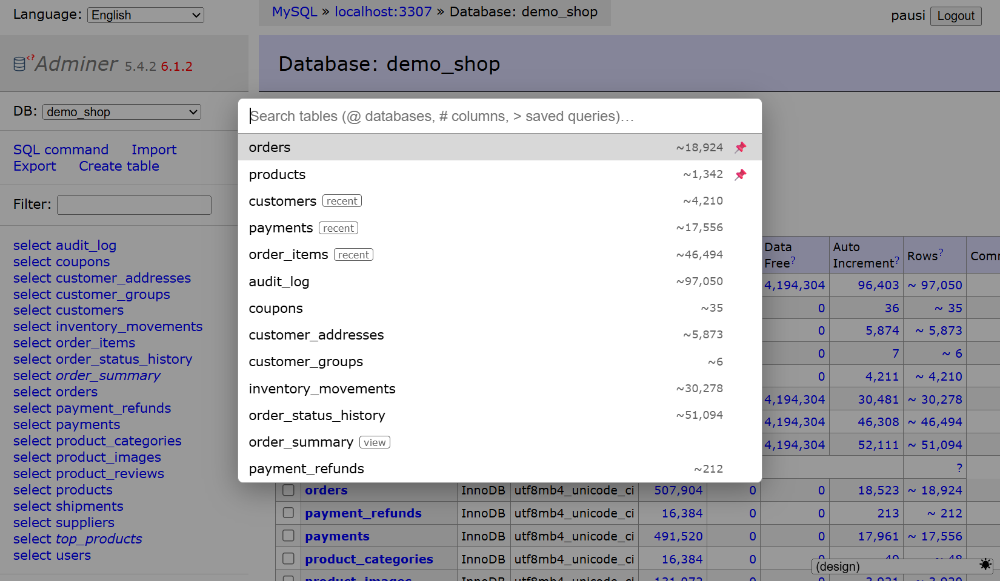
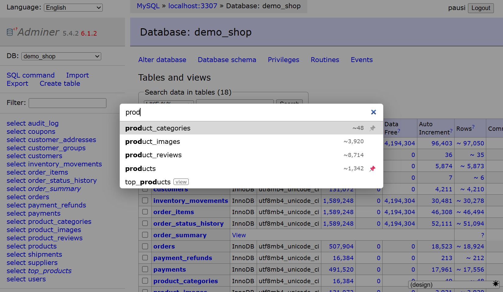
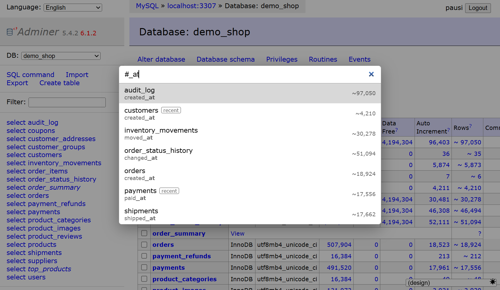
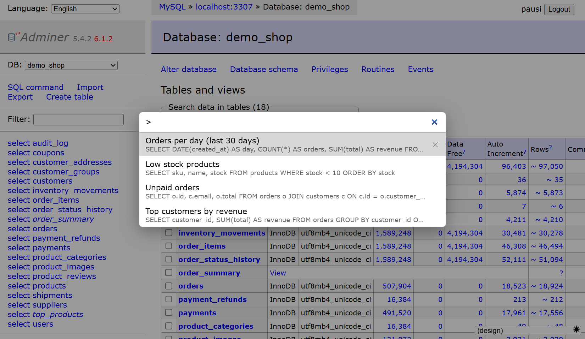

# Adminer Table Search

An Adminer 5 plugin that adds a **Ctrl+K** quick-open dialog, like the command palette in
VS Code, with a fuzzy-ish search over the tables of the current database. Prefixes switch
it to databases (`@`), column names (`#`) and your saved SQL queries (`>`).

It is a single PHP file with no build step and no external requests.



## Features

- **Ctrl+K / Cmd+K anywhere in Adminer** opens a centered search dialog. It works on
  every page, not only on the database page.
- **Words match in any order.** `ord st` finds `order_status_history`. The matched parts
  are shown in bold, and names that start with the first word are listed first.
- **Pinned tables.** Press `Alt+P` or click 📌 to pin a table. When the search is empty,
  pinned tables stay at the top. While you type, pins are ignored so the ranking stays
  purely by match.
- **Recently opened tables** come right after the pins and get a `recent` badge. The last
  10 tables you opened are remembered.
- **Estimated row counts** for every table, right-aligned, and a `view` badge on views.
- **`@` databases.** Switch to another database on the same server.
- **`#` column names.** Find which tables have a column, e.g. `#customer_id`. Column data
  is loaded only when you type `#`, so opening the dialog stays fast on databases with
  many tables and columns.
- **`>` saved queries.** The plugin adds a **Save query** button next to **Execute** on
  the SQL command page. Saved queries open in the SQL editor ready to run, and are never
  executed automatically. Delete one with ✕.
- **Follows the active design.** The dialog takes its colors from the page, so light and
  dark designs, the `designs` plugin and the `dark-switcher` plugin all work.

| Search | `#` column names |
| --- | --- |
|  |  |



## Keyboard

| Key | Action |
| --- | --- |
| `Ctrl+K` / `Cmd+K` | Open the search |
| `↑` / `↓` | Move the selection |
| `Enter` | Open the table data (select page) |
| `Shift+Enter` | Open the table structure |
| `Ctrl+Enter` / `Cmd+Enter` | Open in a new tab |
| `Alt+P` | Pin or unpin the selected table |
| `Esc` | Close |

The mouse works too: click opens the item, `Shift+click` opens the structure, and
`Ctrl+click` or a middle click opens a new tab.

| Prefix | Searches |
| --- | --- |
| *(none)* | Tables and views of the current database |
| `@` | Databases on the server |
| `#` | Column names; the result shows the table and the matching columns |
| `>` | Saved queries, by name and SQL text |

## Requirements

- **Adminer 5.0 or newer.** The plugin uses the `Adminer\` namespace introduced in 5.0,
  so it does **not** work with Adminer 4.x. Tested with Adminer 5.4.2 and 6.1.2.
- A current browser with `<dialog>` support: Chrome/Edge 80+, Firefox 98+, Safari 15.4+.
- Table and database search work with every driver. Row counts and column names are read
  from `information_schema` in a single query on **MySQL/MariaDB**. Other drivers use
  Adminer's own per-table functions, which can be slower on very large databases.

## Installation

Download [`table-search.php`](table-search.php) and do **one** of the following.

**Autoloaded plugin directory (simplest).** Put the file into an `adminer-plugins/`
directory next to your `adminer.php`:

```
adminer.php
adminer-plugins/
    table-search.php
```

Adminer 5 loads every plugin in that directory automatically, so there is nothing else to
configure.

**Explicit plugin list.** If you build the plugin list yourself in `adminer-plugins.php`
(or in your own `adminer_object()`), the class name is `AdminerTableSearch`:

```php
return [
    new AdminerTableSearch(),
];
```

Then log in and press **Ctrl+K**.

## How it works

- The table list comes from the page Adminer has already rendered (the `tablesPrint`
  hook). The dialog and its script are added through the `navigation` hook, so the
  shortcut is available on every page after login.
- Row counts and column names come from a small JSON endpoint on the same Adminer URL:
  `?table-search=rows` and `?table-search=columns`. It runs through Adminer's normal
  login and connection, and only sees what your database user can see.
  - Row counts are requested when the dialog opens.
  - Column names are requested only after you type `#`.
- Row counts are estimates, the same `~` numbers Adminer shows in its table list. For
  InnoDB they can differ from the exact `COUNT(*)`.
- Pins, recent tables and saved queries are kept in the browser's `localStorage`, per
  server, user and database. They are never sent anywhere and are not shared between
  browsers. Clearing your browser data removes them. The keys used are:
  - `adminer_table_search_pins:<url>`
  - `adminer_table_search_recent:<url>`
  - `adminer_saved_queries:<url>`
- The shortcut listener is registered on `window` in the capture phase. Adminer's own
  `body` key handler stops event propagation, so without this the browser's Ctrl+K would
  take over.

## Translations

The interface is in English, with an Indonesian translation included. To add a language,
add an entry to the `$translations` array at the end of the file, keyed by Adminer's
language code.

## Troubleshooting

**Ctrl+K focuses the browser's address or search bar.** Make sure the plugin is actually
loaded: open the browser console on an Adminer page and check that
`document.querySelector('#table-search')` is not `null`. Some browser extensions grab
Ctrl+K before the page sees it.

**`#` says "Columns could not be loaded."** The endpoint returned an error. Open
`?table-search=columns` with your usual Adminer URL parameters in a new tab to see the
response.

**Saved queries are missing on another computer.** They live in the browser's
`localStorage`, so they are per browser.

## Contributing

Issues and pull requests are welcome. The plugin is deliberately a single self-contained
file, so that installing it is a one-file copy. Please keep it that way, follow the
surrounding code style (tabs, Adminer's plugin conventions), and test with both a light
and a dark design before sending a change.

## License

[MIT](LICENSE) © Ahmad Pausi

## Credits

Built for [Adminer](https://www.adminer.org/) by Jakub Vrana.
